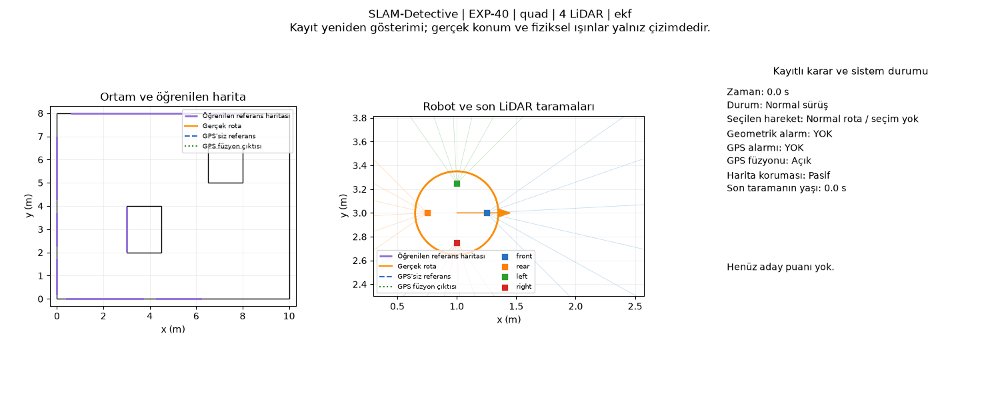
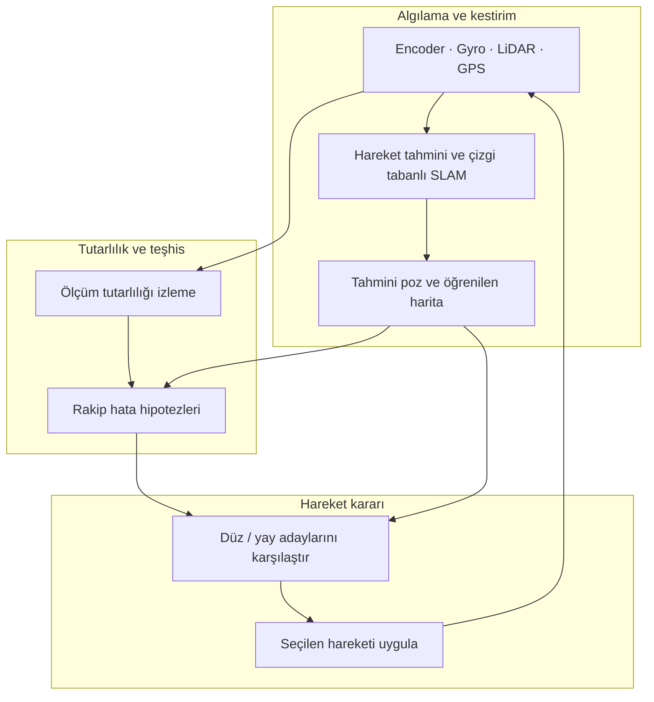
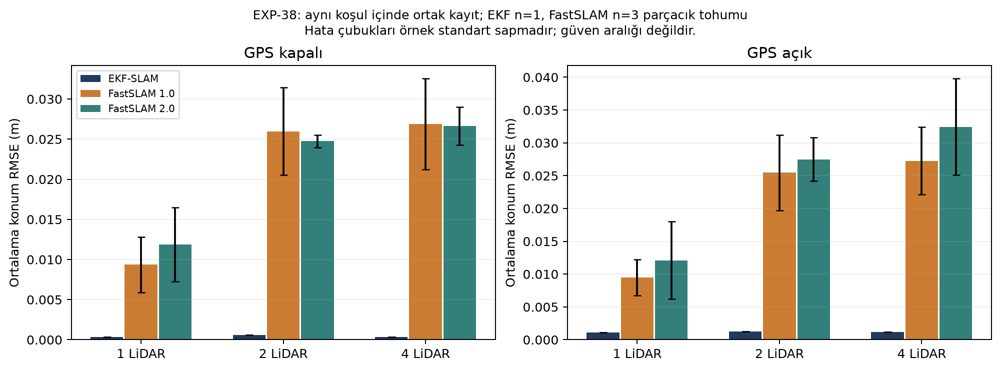

# SLAM-Detective

### Çoklu sensörlü SLAM sistemlerinde hareket seçimiyle hata teşhisi

Robot, sensörler arasındaki tutarsızlığın kaynağını anlamak için **nasıl hareket etmeli?**

SLAM-Detective; ham LiDAR taramalarından harita oluşturan, sensör tutarsızlıklarını izleyen ve hata hipotezlerini ayırmak için kısa teşhis hareketleri seçen bir Python araştırma ortamıdır.

**Çoklu LiDAR &nbsp;·&nbsp; Encoder / Gyro / GPS &nbsp;·&nbsp; EKF-SLAM / FastSLAM &nbsp;·&nbsp; Aktif teşhis**

[Genel bakış](#genel-bakış) · [Mimari](#sistem-mimarisi) · [Sonuçlar](#deneysel-bulgular) · [Başlangıç](#hızlı-başlangıç) · [Dokümantasyon](#dokümantasyon)

---



*Dört LiDAR, EKF-SLAM ve GPS kullanılan kayıtlı bir deney: sol LiDAR montaj hatası, tutarsızlık alarmı ve seçilen hareket.*

Gösterim kayıtlı deneyi yeniden oynatır. Gerçek konum ve fiziksel ışınlar yalnız simülasyon, değerlendirme ve görselleştirme içindir; hareket seçiciye verilmez.

## Genel bakış

Bir robot, konumunu ve çevresini tahmin ederken birden fazla sensörün ölçümlerini birleştirir. Ancak ölçümlerin uyuşmaması, hangi sensörün hatalı olduğunu tek başına açıklamaz.

Örneğin, bir LiDAR’ın montaj açısı hatası ile robotun yön tahminindeki hata benzer belirtiler oluşturabilir. SLAM-Detective, robotun **sonraki hareketini değiştirerek bu belirsizliği azaltıp azaltamayacağını** araştırır.

| Klasik izleme | Aktif teşhis |
| :--- | :--- |
| Mevcut hareket sırasında tutarsızlığı değerlendirir. | Yeni ölçümleri daha ayırt edici hale getirebilecek hareketi seçer. |
| Robot normal rotasını sürdürür. | Robot kısa bir düz veya yay hareketi uygulayabilir. |
| Kanıt yetersiz kalabilir. | Yeni ölçümlerle hata hipotezleri yeniden değerlendirilir. |

Sistem her durumda kesin teşhis koymaz. Yeterli kanıt olmadığında **belirsiz sonuç üretmek**, tasarımın bir parçasıdır.

## Uygulanan bileşenler

| Alan | Kapsam |
| :--- | :--- |
| **Özel simülasyon** | Diferansiyel sürüşlü robot, duvarlar, engeller, bağımsız gerçek konum ve çarpışma kontrolü |
| **Yapılandırılabilir sensörler** | LiDAR sayısı, konumu, yönü, görüş açısı, menzili ve ışın sayısı |
| **Sensör modelleri** | Encoder kuantalaması, gyro gürültüsü/bias, GPS gürültüsü/kesinti/sapma |
| **Ham LiDAR işleme** | Noktalardan çizgi çıkarımı, tarama eşleştirme ve özellik ilişkilendirme |
| **SLAM algoritmaları** | EKF-SLAM ve çizgi özelliklerine uyarlanmış FastSLAM 1.0 / 2.0 |
| **Tutarlılık izleme** | Yenilik/NIS incelemesi, ham tarama hizalama izlemesi ve harita güncelleme koruması |
| **Hareket seçimi** | Tahmini haritada rakip hata modellerinin beklenen ölçüm ayrımına göre düz/yay seçimi |
| **Deney ve analiz** | Eşleştirilmiş politikalar, farklı başlangıçlar, gürültü koşulları ve hareket maliyeti |
| **Gerçek kayıt desteği** | Freiburg 079 LiDAR ve odometri verisinin yeniden oynatılması |

Hazır bir simülatör kullanılmaz. Algoritma ve sensör seçeneklerinin bulunması, bütün kombinasyonlarda aktif teşhis başarısının doğrulandığı anlamına gelmez.

## Sistem mimarisi



**Karar mekanizmasının kullandıkları:** sensör ölçümleri, mevcut konum tahmini ve öğrenilen harita.

**Yalnız simülasyon ve değerlendirmede kullanılanlar:** gerçek konum, gerçek hata etiketi ve kusursuz ortam geometrisi.

Geometrik aday puanı, teşhis olasılığı veya formel bilgi kazancı değildir. Hareket maliyeti ayrıca ölçülür; mevcut seçici maliyet optimizasyonu yapmaz.

[Mimari ayrıntıları](docs/ARCHITECTURE.md) · [Algoritmalar](docs/ALGORITHMS.md) · [Aktif teşhis](docs/ACTIVE_DIAGNOSIS.md)

## Deneysel bulgular

### Hareket değişikliği kaynak ayrımına yardımcı olabilir

Koridor ortamında, normal rotası yay olan robotun ön LiDAR’ına **+5° montaj hatası** uygulandı. Politikalar aynı başlangıç koşullarını ve alarm öncesi ölçüm geçmişini paylaştı.

Başarı ölçütü, alarmdan sonraki iki saniyede doğru hata kaynağının doğrulanmasıydı.

| Politika | Doğru kaynak | Belirsiz | Uygulanan davranış |
| :--- | ---: | ---: | :--- |
| Pasif | 0/10 | 10/10 | Normal yay rotasını sürdürdü |
| Sabit yay | 0/10 | 10/10 | Yay hareketi uyguladı |
| Sabit düz | 10/10 | 0/10 | Düz harekete geçti |
| **Adaptif** | **10/10** | **0/10** | **Düz hareketi seçti** |

**Bu koşulda düz harekete geçmek kaynak doğrulamasına yardımcı oldu.** Sabit düz politika da aynı sonucu verdi; adaptif yöntemin bütün sabit politikalardan üstün olduğu gösterilmedi.


*İki ortam, iki normal rota, üç hata koşulu ve on tohumla yapılan değerlendirme: 120 temel koşul, dört politika, toplam 480 çalıştırma.*

Diğer +5° ortam/rota hücrelerinde politikaların doğru kaynak sayıları eşitti. İncelenen +2° koşullarında hiçbir politika alarm üretmedi.

### Farklı başlangıçlar ve gürültülü ölçümler

Genişletilmiş değerlendirme, yöntemin tek bir başlangıca ve ideal LiDAR ölçümlerine bağlılığını araştırır.

| Deney değişkeni | Değerlendirilen koşullar |
| :--- | :--- |
| Ortam | Koridor ve asimetrik engelli oda |
| Normal rota | Düz ve yay |
| Başlangıç | Üç farklı konum/yön düzeni |
| LiDAR ölçümü | İdeal veya 1 cm standart sapmalı menzil gürültüsü + %1 ışın kaybı |
| Montaj hatası | 0°, +2°, +5° |
| Politika | Pasif, sabit düz, sabit yay, adaptif |
| Tekrar | Üç değerlendirme tohumu |

**216 eşleştirilmiş temel koşul × 4 politika = 864 çalıştırma.**

Geliştirme kopyasında tamamlanan referans çalışmanın seçilmiş sonuçları:

| Ön LiDAR hatası | Ölçüm koşulu | Adaptif doğru kaynak | Sabit düz doğru kaynak |
| :--- | :--- | ---: | ---: |
| +5° | İdeal | 36/36 | 36/36 |
| +5° | Gürültülü | 29/36 | 30/36 |

Bu toplamlar farklı ortam, başlangıç ve rota hücrelerini birleştirir; tek koşulda 36 bağımsız tekrar değildir. +2° hatalar bu değerlendirmede de alarm üretmedi.

**Çıkarım:** Hareket seçimi bazı koşullarda yararlı olsa da her koşulda en başarılı politika değildir. Gürültü, belirsiz sonuçları artırabilir.

Değerlendirme; doğru kaynak, yanlış alarm, belirsizlik ve teşhis gecikmesinin yanında ortak zaman ufkundaki **mesafe ve mutlak dönüşü** de raporlar. Kalibrasyon sağlıklı ve ideal kayıtlardan dondurulur; gürültülü koşullar bir dağılım değişimi stres testidir.

[Değerlendirme yöntemi ve komutlar](docs/ROBUSTNESS_BENCHMARK.md)

### Ortam çeşitliliği


*Koridor ve asimetrik engelli oda. Çizilen yörüngeler bir tohumun örneğidir; başarı tabloları tam değerlendirmeden gelir.*

### Algoritma karşılaştırması



İncelenen nominal kayıtlarda EKF daha düşük konum RMSE verdi. FastSLAM 2.0 her koşulda FastSLAM 1.0’dan daha iyi sonuç vermedi.

Parçacıklı yöntemlerin tekrarları parçacık tohumlarıdır; bağımsız sensör kayıtları değildir. Grafik genel bir algoritma sıralaması olarak yorumlanmamalıdır.

## Hızlı başlangıç

**Python 3.13 · Windows PowerShell**

Proje kökünde sanal ortamı oluşturup bağımlılıkları kurun. Mevcut `.venv` varsa ilk komutu atlayın.

```powershell
py -3.13 -m venv .venv
.\.venv\Scripts\python.exe -m pip install -r requirements.txt
.\.venv\Scripts\python.exe -m pip install pillow
```

### Sağlıklı kontrol

```powershell
.\.venv\Scripts\python.exe main.py active --config config/sensors/quad.json --fault healthy --no-gps
```

### Sol LiDAR montaj hatası

```powershell
.\.venv\Scripts\python.exe main.py active --config config/sensors/quad.json --fault-sensor left --no-gps
```

### Testler

```powershell
.\.venv\Scripts\python.exe -m unittest discover -s tests -v
```

Çalıştırma sonuçları `results/` altında saklanır. Kayıtlı EKF/quad kontrolünde sağlıklı koşul alarm üretmezken sol LiDAR +5° örneğinde alarm ve yay seçimi görülmüştür. Bu tekil kontrol, genel başarı garantisi değildir.

[Kurulum ve kullanım](docs/GETTING_STARTED.md) · [Deney rehberi](docs/EXPERIMENTS.md) · [Gürültü ve başlangıç değerlendirmesi](docs/ROBUSTNESS_BENCHMARK.md)

<details>
<summary><strong>Diğer çalıştırma seçenekleri</strong></summary>

### SLAM algoritmalarını karşılaştırma

```powershell
.\.venv\Scripts\python.exe main.py compare
```

### Genişletilmiş değerlendirme için kısa kontrol

```powershell
$env:OPENBLAS_NUM_THREADS = "1"
.\.venv\Scripts\python.exe -m experiments.exp_43_robustness --smoke
```

Bu komut 24 çalıştırmalık bağlantı kontrolüdür; tam değerlendirme değildir.

Tam protokol, rapor ve dört politikalı GIF üretimi için [ayrıntılı rehbere](docs/ROBUSTNESS_BENCHMARK.md) bakın.

### Gerçek LiDAR kaydını yeniden oynatma

```powershell
.\.venv\Scripts\python.exe main.py real --download
```

Freiburg 079 LiDAR ve kayıtlı odometri kullanılır. Ham kayıt `data/raw/` altında tutulur ve depoya eklenmez.

Bağımsız gerçek konum bulunmadığından doğruluk RMSE/ATE’si hesaplanmaz. Kayıt üzerinde yeni teşhis hareketi uygulanmaz.

[Veri kaynağı ve kullanım notları](docs/real_data.md)

</details>

## Proje yapısı

| Dizin | Sorumluluk |
| :--- | :--- |
| `simulator/` | Robot, ortam, sensörler ve ölçüm bozulmaları |
| `perception/` | Ham taramalardan çizgi çıkarımı ve veri eşleştirme |
| `estimation/` | SLAM, füzyon, tutarlılık izleme ve hareket seçimi |
| `experiments/` | Deney protokolleri ve çalıştırıcılar |
| `analytics/` | Sayısal değerlendirme, tablolar ve grafikler |
| `visualization/` | Kayıtlı deneylerden hareketli gösterim |
| `dataset_loaders/` | Gerçek veri okuma |
| `config/` | Sensör yerleşimleri ve deney ayarları |
| `tests/` | Sayısal, davranışsal ve protokol kontrolleri |
| `docs/` | Yöntem, sonuçlar, kullanım ve sınırlamalar |

## Doğrulama ve bilinen sınırlar

Genişletilmiş değerlendirme eklentisinin kontrol edildiği geliştirme kopyasında **334 test geçti**. Bu, kayıtlı yerel doğrulama sonucudur; canlı CI durumu değildir. Eklenti Python 3.12 üzerinde kontrol edilmiştir; projenin ilk geliştirme ortamı Python 3.13.3’tür.

| Başlık | Sınır |
| :--- | :--- |
| **Kaynak ayrımı** | Mevcut yöntem en az iki destekli LiDAR gerektirir; tek LiDAR ile haritalama yapılabilir. |
| **Küçük hatalar** | İncelenen +2° montaj hataları alarm üretmemiştir. |
| **GPS teşhis hareketi** | Yalnız GPS hatasına özel hareket seçimi uygulanmamıştır. |
| **FastSLAM ile aktif teşhis** | İncelenen dört LiDAR +5° örneğinde alarm oluşmamıştır. |
| **Sonuçların kapsamı** | Genişletilmiş aktif teşhis değerlendirmesi EKF tabanlıdır; bütün algoritmalara genellenmez. |
| **Başlangıç bilgisi** | Başlangıç pozu öncül olarak verilir; başlangıç belirsizliği çözülmez. |
| **Maliyet** | Hareket maliyeti ölçülür; seçici tarafından optimize edilmez. |
| **Gerçek dünya** | Simülasyon sonuçları donanım doğrulaması veya güvenlik garantisi değildir. |

FastSLAM uygulamaları çizgi özelliklerine uyarlamadır; özgün makalelerin birebir tekrarı veya ağaç tabanlı karmaşıklık avantajının doğrulaması değildir. Literatürde ilk yöntem olma iddiası bulunmaz.

[Sınırlamalar](docs/LIMITATIONS.md) · [Yeniden üretilebilirlik](docs/REPRODUCIBILITY.md) · [Görsel kaynakları](docs/assets/README.md)

## Dokümantasyon

| Projeyi tanı | Yöntemi incele | Deneyleri çalıştır |
| :--- | :--- | :--- |
| [Genel proje tanımı](docs/PROJECT_OVERVIEW.md) | [Sistem mimarisi](docs/ARCHITECTURE.md) | [Deney rehberi](docs/EXPERIMENTS.md) |
| [Kurulum ve kullanım](docs/GETTING_STARTED.md) | [SLAM algoritmaları](docs/ALGORITHMS.md) | [Araştırma bulguları](docs/RESEARCH_FINDINGS.md) |
| [Sensörler ve simülatör](docs/SIMULATOR_AND_SENSORS.md) | [Aktif teşhis](docs/ACTIVE_DIAGNOSIS.md) | [Ek ortam değerlendirmesi](docs/heldout_environments.md) |
| [Gerçek veri](docs/real_data.md) | [Yeniden üretilebilirlik](docs/REPRODUCIBILITY.md) | [Gürültü ve başlangıç değerlendirmesi](docs/ROBUSTNESS_BENCHMARK.md) |

[Tüm belgeler →](docs/README.md)
