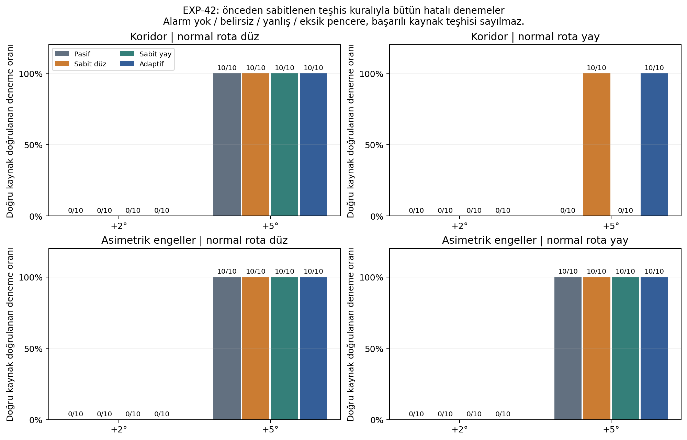
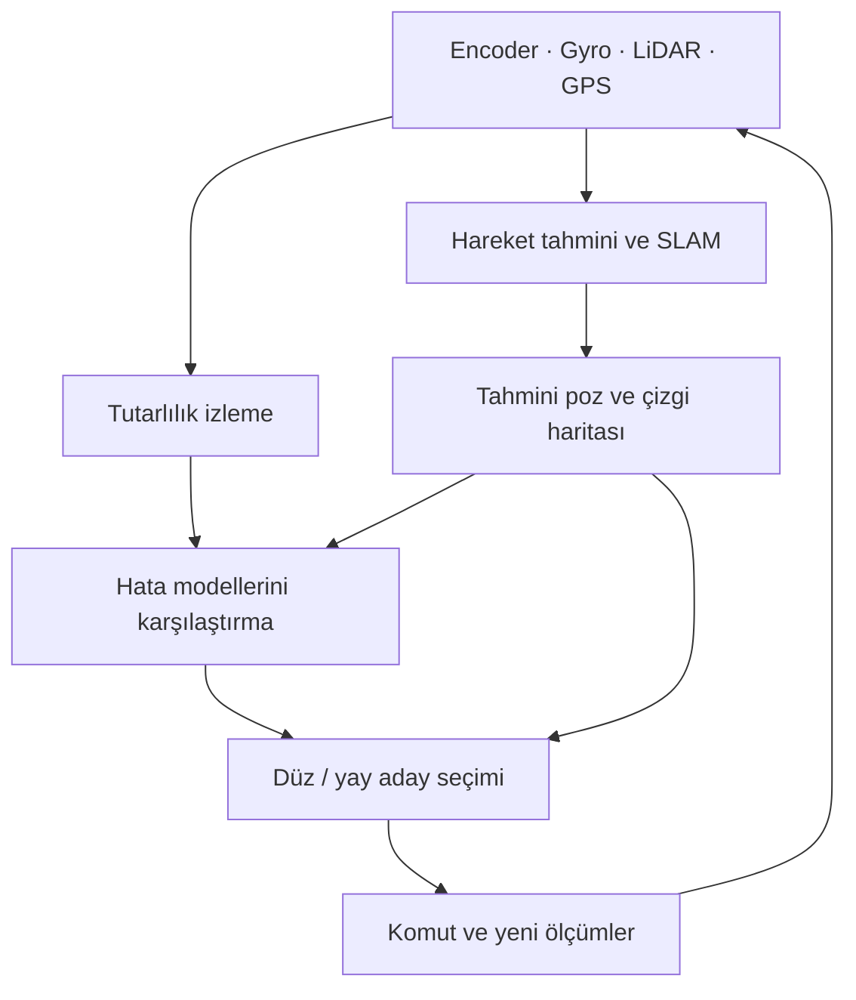

<div align="center">

# SLAM-Detective

### Çoklu sensörlü SLAM sistemlerinde hareket seçimiyle hata teşhisi

**Robot, anlamadığı bir sensör hatasını hareketini değiştirerek ayırt edebilir mi?**


[Başlangıç](#hızlı-başlangıç) · [Deney sonucu](#hareket-ne-zaman-fark-yarattı) · [Mimari](#sistem-mimarisi) · [Dokümantasyon](docs/README.md)

</div>

<p align="center">
  
</p>

*EXP-40 kaydının yeniden gösterimi: dört LiDAR, EKF-SLAM, sol LiDAR montaj hatası ve GPS açık koşulu. Harita, ölçümler, alarm ve kayıtlı hareket seçimi birlikte gösterilir. Gerçek konum ve fiziksel ışınlar yalnız simülasyon üretimi/değerlendirme ve çizim içindir; karar mekanizmasına verilmez.*

## Neyi araştırıyoruz?

Bir robotun ölçümleri uyuşmadığında iki ayrı problem ortaya çıkar: **Bir hata var mı? Hata nereden geliyor?** Örneğin bir LiDAR'ın montaj açısındaki sapma ile robotun yön tahminindeki sapma bazı koşullarda benzer belirtiler oluşturabilir. Üstelik hatalı ölçümler haritaya işlendiğinde harita da hatayı öğrenebilir.

SLAM-Detective; robotun kendi haritasını oluşturduğu, sensör tutarsızlığını izlediği ve tanımlı hata modellerini ayırmak için kısa bir **düz veya yay hareketi seçtiği** Python deney ortamıdır. Hazır robot simülatörü kullanılmaz.

Projenin odağı yalnız konum hatasını azaltmak değil, **hareketin hata teşhisine katkısını ölçmektir.** Alarm üretimi, kaynak teşhisi ve hareket seçiminin faydası ayrı değerlendirilir.

## Hareket ne zaman fark yarattı?

**EXP-42 — Koridor, normal rota yay, ön LiDAR'da +5° montaj hatası.**

Aynı başlangıç ve ölçüm geçmişinden gelen dört politika karşılaştırıldı. Alarm sonrasındaki iki saniyede doğru kaynağın doğrulanması için aynı model ve açı işaretinin iki ardışık destekli taramada aday olması istendi.

| Politika | Doğru kaynak doğrulaması | Belirsiz | Alarm sonrası hareket |
| --- | ---: | ---: | --- |
| Pasif | 0/10 | 10/10 | Normal yay rotası |
| Sabit yay | 0/10 | 10/10 | Yay |
| Sabit düz | 10/10 | 0/10 | Düz |
| **Adaptif** | **10/10** | **0/10** | **Düz hareketi seçti** |

Bu koşulda hareket değişikliği, teşhis için gereken kanıtı sağladı. **Sabit düz de aynı başarıyı verdi:** sonuç adaptif yöntemin bütün sabit politikalardan üstün olduğunu göstermez.

<p align="center">
  
</p>

*Bütün ortam/rota koşulları birlikte gösterilir. Diğer +5° hücrelerinde politikaların doğru kaynak sayıları eşitti. +2° hatalarda hiçbir politika alarm üretmedi; bu, küçük hata duyarlılığının sınırıdır.*

**Deney kapsamı:** 2 ek ortam × 2 normal rota × 3 hata büyüklüğü × 4 politika × 10 tohum = **480 politika çalıştırması**. Bunlar **120 eşleştirilmiş temel koşulun** dört politikasıdır; 480 bağımsız sensör kaydı değildir. Kalibrasyon yalnız önceki ortamın sağlıklı kayıtlarından yapılmış ve test öncesinde dondurulmuştur.

[Protokol ve başarı tanımı](docs/heldout_environments.md) · [Bulguların yorumu](docs/RESEARCH_FINDINGS.md)

## Neler uygulandı?

| Bileşen | Uygulanan çalışma |
| --- | --- |
| **Özel 2B simülatör** | Diferansiyel sürüş, duvar/engel geometrisi, çarpışma kontrolü, bağımsız gerçek konum |
| **Çoklu LiDAR** | JSON üzerinden sayı, kimlik, montaj, görüş açısı, ışın sayısı ve menzil; 1/2/4 örnek düzen |
| **Diğer sensörler** | Encoder kuantalaması, düzlemsel gyro gürültüsü/bias, GPS gürültüsü/kesintisi/sapması |
| **Ham LiDAR işleme** | Noktalardan çizgi çıkarımı, veri eşleştirme, çizgi haritası oluşturma |
| **SLAM çekirdekleri** | Çizgi EKF-SLAM ve çizgi temelli FastSLAM 1.0/2.0 uyarlamaları |
| **Tutarlılık izleme** | Yenilik/NIS incelemesi, ham tarama hizalama izlemesi, şüphede LiDAR güncellemelerini askıya alma |
| **Kaynak modelleri** | Destekli LiDAR'ların montaj yaw hataları ve ortak yön sapması |
| **Hareket seçimi** | Tahmini haritada rakip modellerin beklenen ölçüm ayrımına göre düz/yay seçimi |
| **GPS koruması** | GPS'siz referansla kontrol ve isteğe bağlı korumalı GPS füzyonu |
| **Gerçek veri** | Freiburg 079 CARMEN LiDAR + kayıtlı odometri yeniden oynatımı |
| **Analiz ve gösterim** | Eşleştirilmiş politika tabloları, grafikler ve kayıttan GIF üretimi |

## Sistem mimarisi



Seçici gerçek hata etiketini, gerçek konumu veya kusursuz ortam haritasını almaz. Karar, robotun **mevcut tahmini ve oluşturduğu harita** üzerinden verilir. Geometrik aday puanı teşhis olasılığı veya formel bilgi kazancı değildir.

| Klasör | Görevi |
| --- | --- |
| `simulator/` | Hareket, ortam ve sensör üretimi |
| `perception/` | Çizgi çıkarımı ve veri eşleştirme |
| `estimation/` | Kestirim, alarm, hata modelleri ve hareket seçimi |
| `experiments/` | Kontrollü deneyler ve çevrimdışı değerlendirme |
| `dataset_loaders/` | Gerçek kayıt okuma |
| `analytics/` | Sonuç tabloları ve grafikler |
| `visualization/` | Kayıttan hareketli gösterim |
| `config/sensors/` | Sensör düzenleri |

[Mimari açıklaması](docs/ARCHITECTURE.md) · [Algoritmalar](docs/ALGORITHMS.md) · [Teşhis ve karar](docs/ACTIVE_DIAGNOSIS.md)

## Hızlı başlangıç

Komutları proje kökünde Windows PowerShell üzerinde çalıştırın. Mevcut `.venv` varsa yeniden oluşturmayın.

```powershell
py -3.13 -m venv .venv
.\.venv\Scripts\python.exe -m pip install numpy matplotlib pillow
.\.venv\Scripts\python.exe -m unittest discover -s tests -v
```

Örnek sensör dosyaları henüz yoksa oluşturun:

```powershell
.\.venv\Scripts\python.exe main.py layouts
```

**Önce sağlıklı kontrol, ardından hatalı sensör:**

```powershell
.\.venv\Scripts\python.exe main.py active --config config/sensors/quad.json --fault healthy --no-gps
.\.venv\Scripts\python.exe main.py active --config config/sensors/quad.json --fault-sensor left --no-gps
```

Varsayılan EKF/quad örneğinde sağlıklı koşulda alarm oluşmaz; sol LiDAR +5° örneğinde 2.5 s'de alarm ve yay seçimi doğrulanmıştır. Bu tekil bütünleştirme kontrolüdür, genel başarı oranı değildir.

### Gösterim oluşturma

```powershell
.\.venv\Scripts\python.exe main.py active-demo --run "results\EXP40_KLASORU"
```

`EXP40_KLASORU` yerine terminalde yazdırılan gerçek çıktı klasörünü kullanın. Gösterim kayıtlı deneyi yeniden oynatır; başka hareket altında yeni bir deney yapmaz.

### Ek ortam değerlendirmesi

```powershell
$env:OPENBLAS_NUM_THREADS = "1"
.\.venv\Scripts\python.exe -m experiments.exp_42_heldout_environments --save-recordings
.\.venv\Scripts\python.exe -m analytics.heldout_environment_results --run "results\EXP42_KLASORU"
```

Tam protokol 480 çalıştırmadır. `--seeds 1201` kısa bağlantı kontrolü içindir; tam sonuç yerine geçmez. `--save-recordings` isteğe bağlı ham kayıt saklamayı açar.

## Deney ortamları

<p align="center">
  
</p>

*EXP-42: koridor ve asimetrik engelli oda. Çizilen yörüngeler seçilmiş bir tohumun örneğidir; başarı sayıları bütün 10 tohumdan gelir.*

## Algoritma karşılaştırması

```powershell
.\.venv\Scripts\python.exe main.py compare
```

<p align="center">
  
</p>

*EXP-38'in incelenen nominal koşullarında EKF daha düşük RMSE verdi. FastSLAM 2.0 her koşulda FastSLAM 1.0'dan iyi çıkmadı. Parçacıklı yöntemlerin tekrarları parçacık tohumlarıdır; bağımsız sensör kayıtları değildir. Bu grafik genel algoritma sıralaması değildir.*

FastSLAM çekirdekleri çizgi özelliklerine uyarlamadır; özgün makalelerin birebir tekrarı veya ağaç tabanlı karmaşıklık avantajının doğrulaması değildir.

## Gerçek veri desteği

```powershell
.\.venv\Scripts\python.exe main.py real --download
```

Freiburg 079 kaydındaki LiDAR ve odometri yeniden oynatılır. Varsayılan ilk 40 seçilmiş tarama yaklaşık 25.17 saniyeyi kapsar. **Bağımsız gerçek konum kullanılmadığından doğruluk RMSE/ATE'si hesaplanmaz; kayıtta yeni teşhis hareketi uygulanmış gibi sunulmaz.** Ham dosya `data/raw/` altında tutulur ve depoya eklenmez.

[Kaynak, veri biçimi ve kullanım notları](docs/real_data.md)

## Doğrulama ve kapsam

Gönderilen güncel proje kopyasında **319 test geçti**. Bu statik doğrulama kaydıdır; canlı CI rozeti değildir. EXP-42 kaydında 480 çalışma ve gerekli süreler tamamlandı; eski çekirdekler ile dondurulmuş kalibrasyon korunmuştu.

- Mevcut kaynak ayrımı en az iki destekli LiDAR ister; tek LiDAR haritalama yapabilir.

- Yalnız GPS hatası için teşhis hareketi seçen öteleme modeli uygulanmamıştır.

- İncelenen dört-LiDAR/FastSLAM +5° örneğinde alarm oluşmamıştır.

- EXP-42 yalnız EKF, dört LiDAR, iki ek ortam ve ön montaj hatasını kapsar.

- Bilinmeyen alanda çarpışmama veya gerçek robot güvenliği garantisi yoktur.

- Akademik yöntem yeniliği, ayrı sistematik literatür incelemesi gerektirir.

[Sınırlar](docs/LIMITATIONS.md) · [Yeniden üretilebilirlik](docs/REPRODUCIBILITY.md) · [Görsel kaynakları](docs/assets/README.md)

## Dokümantasyon

**[Dokümantasyon rehberi →](docs/README.md)**

[Proje tanımı](docs/PROJECT_OVERVIEW.md) · [Kurulum](docs/GETTING_STARTED.md) · [Sensörler](docs/SIMULATOR_AND_SENSORS.md) · [Deneyler](docs/EXPERIMENTS.md) · [Bulgular](docs/RESEARCH_FINDINGS.md)

---
