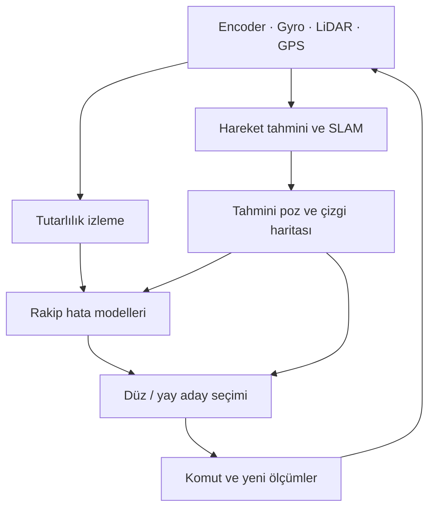
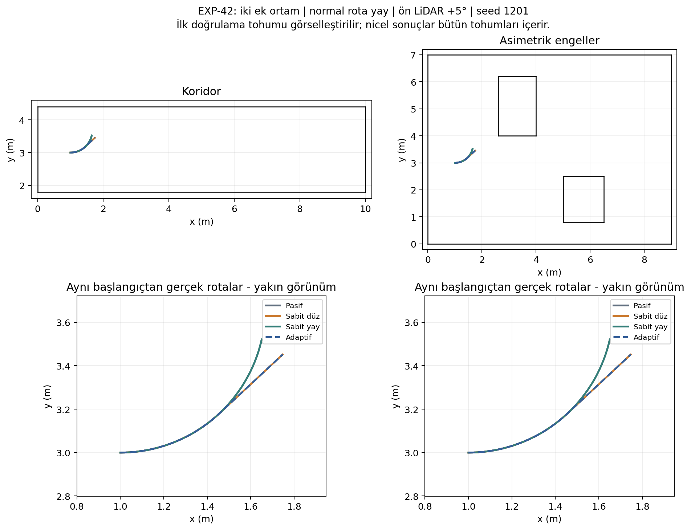

# SLAM-Detective

**Çoklu sensörlü SLAM sistemlerinde hareket seçimiyle hata teşhisi.**

Çoklu LiDAR · Sensör füzyonu · Çizgi tabanlı SLAM · Aktif teşhis


[Genel bakış](#genel-bakış) · [Bulgular](#öne-çıkan-deney) · [Başlangıç](#hızlı-başlangıç) · [Dokümantasyon](docs/README.md)

<p align="center">
  
</p>

<p align="center">
  <sub>EXP-40 · Dört LiDAR · EKF-SLAM · Sol LiDAR montaj hatası · GPS açık</sub>
</p>

Gösterim kayıtlı deneyi yeniden oynatır; alarm, harita koruması ve seçilen hareket birlikte izlenir. Gerçek konum ve fiziksel ışınlar üretim/değerlendirme ve çizim içindir; seçiciye verilmez.

---

## Genel bakış

> **Robot, anlamadığı bir sensör hatasını hareketini değiştirerek ayırt edebilir mi?**

SLAM-Detective, robotun ham LiDAR verisinden harita oluşturduğu, sensör tutarsızlıklarını izlediği ve rakip hata modellerini ayırmak için kısa bir **düz veya yay hareketi seçtiği** Python araştırma ortamıdır.

Bir tutarsızlığı yakalamak, kaynağını belirlemekle aynı şey değildir. LiDAR montaj hatası ve robotun yön tahminindeki hata bazı koşullarda benzer belirtiler oluşturabilir. Proje, robotun sonraki hareketinin bu ayrımı nasıl etkilediğini kontrollü deneylerle inceler.

## Öne çıkan deney

**Koridor ortamı · Normal rota: yay · Ön LiDAR montaj hatası: +5°**

EXP-42'de politikalar aynı başlangıç ve alarm öncesi ölçüm geçmişiyle karşılaştırıldı. Birincil sonuç, alarmdan sonraki iki saniyede doğru hata kaynağının doğrulanmasıdır.

| Politika | Doğru kaynak | Belirsiz | Davranış |
| :--- | ---: | ---: | :--- |
| Pasif | 0/10 | 10/10 | Yay rotasını sürdürdü |
| Sabit yay | 0/10 | 10/10 | Yay uyguladı |
| Sabit düz | 10/10 | 0/10 | Düz harekete geçti |
| **Adaptif** | **10/10** | **0/10** | **Düz hareketi seçti** |

**Yorum:** Bu koşulda hareket değişikliği teşhis için gereken kanıtı sağladı. Sabit düz de aynı sonucu verdi; adaptif yöntemin bütün sabit politikalardan üstün olduğu gösterilmedi.

<p align="center">
  
</p>

- Diğer +5° ortam/rota hücrelerinde politikaların doğru kaynak sayıları eşitti.
- +2° hatalarda hiçbir politika alarm üretmedi; küçük hata duyarlılığı sınırlıdır.
- Başarı, aynı model ve açı işaretinin iki ardışık destekli taramada aday olmasıyla doğrulandı.
- Kalibrasyon yalnız önceki ortamın sağlıklı kayıtlarından yapıldı ve test öncesinde donduruldu.

**2 ortam × 2 normal rota × 3 hata × 4 politika × 10 tohum = 480 politika çalıştırması.** Bunlar 120 eşleştirilmiş temel koşulun dört politikasıdır; 480 bağımsız sensör kaydı değildir.

[Deney protokolü](docs/heldout_environments.md) · [Bulgular ve yorum](docs/RESEARCH_FINDINGS.md)

## Yetenekler

| Alan | Uygulanan çalışma |
| :--- | :--- |
| **Simülasyon** | Hazır simülatör kullanmadan diferansiyel sürüş, duvarlar, engeller ve çarpışma kontrolü |
| **Sensörler** | Yapılandırılabilir LiDAR; encoder kuantalaması; düzlemsel gyro gürültüsü/bias; GPS gürültüsü, kesinti ve sapma |
| **Algılama ve SLAM** | Ham noktalardan çizgi çıkarımı, veri eşleştirme, EKF-SLAM ve çizgi temelli FastSLAM uyarlamaları |
| **Teşhis** | Yenilik/NIS incelemesi, ham tarama hizalama izlemesi, montaj/yön hata modelleri ve harita güncelleme koruması |
| **Karar** | Mevcut tahmini haritada rakip modellerin beklenen ölçüm ayrımına göre düz/yay seçimi |
| **GPS ve gerçek veri** | GPS'siz referansla korumalı füzyon; Freiburg 079 LiDAR/odometri yeniden oynatımı |
| **Değerlendirme** | Eşleştirilmiş politika karşılaştırmaları, tablo/grafik üretimi ve kayıttan GIF |

## Sistem mimarisi

Kararlar yalnız ölçümler, mevcut tahmin ve öğrenilen haritayla alınır. Gerçek hata etiketi, gerçek konum ve kusursuz ortam haritası karar mekanizmasına verilmez.



Geometrik aday puanı teşhis olasılığı veya formel bilgi kazancı değildir.

| Konum | Sorumluluk |
| :--- | :--- |
| `simulator/` | Hareket, ortam ve sensör üretimi |
| `perception/` | Çizgi çıkarımı ve veri eşleştirme |
| `estimation/` | Kestirim, tutarlılık izleme, hata modelleri ve karar |
| `experiments/` | Deney protokolleri ve çevrimdışı değerlendirme |
| `dataset_loaders/` | Gerçek kayıt okuma |
| `analytics/` | Tablo ve grafikler |
| `visualization/` | Kayıttan gösterim |
| `config/sensors/` | Sensör yerleşimleri ve ayarları |

[Mimari açıklaması](docs/ARCHITECTURE.md) · [Algoritmalar](docs/ALGORITHMS.md) · [Aktif teşhis](docs/ACTIVE_DIAGNOSIS.md)

## Hızlı başlangıç

Windows PowerShell üzerinde proje kökünde çalıştırın. Mevcut `.venv` varsa yeniden oluşturmayın.

```powershell
py -3.13 -m venv .venv
.\.venv\Scripts\python.exe -m pip install numpy matplotlib pillow
.\.venv\Scripts\python.exe -m unittest discover -s tests -v
```

Örnek sensör dosyaları henüz yoksa:

```powershell
.\.venv\Scripts\python.exe main.py layouts
```

**Sağlıklı kontrol ve sol LiDAR hatası:**

```powershell
.\.venv\Scripts\python.exe main.py active --config config/sensors/quad.json --fault healthy --no-gps
.\.venv\Scripts\python.exe main.py active --config config/sensors/quad.json --fault-sensor left --no-gps
```

Varsayılan EKF/quad örneğinde sağlıklı koşulda alarm oluşmaz; sol LiDAR +5° örneğinde 2.5 s'de alarm ve yay seçimi doğrulanmıştır. Bu tekil bütünleştirme kontrolüdür; genel başarı oranı değildir.

### Kayıttan hareketli gösterim

```powershell
.\.venv\Scripts\python.exe main.py active-demo --run "results\EXP40_KLASORU"
```

Yer tutucuyu terminalde yazdırılan gerçek klasör adıyla değiştirin. Bu komut başka bir hareket altında yeni deney yapmaz.

### Ek ortam değerlendirmesi

```powershell
$env:OPENBLAS_NUM_THREADS = "1"
.\.venv\Scripts\python.exe -m experiments.exp_42_heldout_environments --save-recordings
.\.venv\Scripts\python.exe -m analytics.heldout_environment_results --run "results\EXP42_KLASORU"
```

Tam protokol 480 çalıştırmadır. `--seeds 1201` yalnız kısa bağlantı kontrolüdür. `--save-recordings` isteğe bağlı ham kayıt saklamayı açar.

### Algoritma karşılaştırması

```powershell
.\.venv\Scripts\python.exe main.py compare
```

### Gerçek veri

```powershell
.\.venv\Scripts\python.exe main.py real --download
```

Freiburg 079 LiDAR ve kayıtlı odometri kullanılır. Varsayılan ilk 40 seçilmiş tarama yaklaşık 25.17 saniyedir. Ham kayıt `data/raw/` altında tutulur ve depoya eklenmez. Bağımsız gerçek konum olmadığı için doğruluk RMSE/ATE'si hesaplanmaz; gerçek kayıtta yeni teşhis hareketi uygulanmaz.

[Veri kaynağı ve kullanım notları](docs/real_data.md)

## Deney ortamları ve algoritma karşılaştırması

### Ortamlar ve politika yörüngeleri

<p align="center">
  
</p>

Koridor ve asimetrik engelli oda. Yörüngeler bir tohumun örneğidir; sayısal başarı sonuçları bütün 10 tohumdan gelir.

### SLAM algoritmaları ve konum hatası

<p align="center">
  
</p>

İncelenen nominal koşullarda EKF daha düşük RMSE verdi. FastSLAM 2.0 her koşulda FastSLAM 1.0'dan iyi çıkmadı. Parçacıklı yöntemlerin tekrarları parçacık tohumlarıdır; bağımsız sensör kayıtları değildir. Grafik genel algoritma sıralaması değildir.

FastSLAM çekirdekleri çizgi özelliklerine uyarlamadır; özgün makalelerin birebir tekrarı veya ağaç tabanlı karmaşıklık avantajının doğrulaması değildir.

## Doğrulama ve sınırlar

İncelenen proje kopyasında **319 test geçti**. EXP-42'de 480 çalışma ve gerekli süreler tamamlandı; eski çekirdekler ve dondurulmuş kalibrasyon korunmuştu. Bunlar kayıtlı doğrulama sonuçlarıdır; canlı CI durumu değildir.

| Kapsam | Sınır |
| :--- | :--- |
| **Kaynak ayrımı** | Mevcut yöntem en az iki destekli LiDAR ister; tek LiDAR haritalama yapabilir. |
| **GPS hareket seçimi** | Yalnız GPS hatası için öteleme hipotezli teşhis hareketi uygulanmamıştır. |
| **FastSLAM alarmı** | İncelenen dört-LiDAR +5° örneğinde alarm oluşmamıştır. |
| **EXP-42** | EKF, dört LiDAR, iki ek ortam ve ön montaj hatasıyla sınırlıdır. |
| **Güvenlik ve yenilik** | Bilinmeyen alanda güvenlik garantisi veya literatürde ilk yöntem iddiası yoktur. |

[Sınırlamalar](docs/LIMITATIONS.md) · [Yeniden üretilebilirlik](docs/REPRODUCIBILITY.md) · [Görsel kaynakları](docs/assets/README.md)

## Dokümantasyon

| Başlamak için | Teknik ayrıntılar | Deney ve sonuçlar |
| :--- | :--- | :--- |
| [Proje tanımı](docs/PROJECT_OVERVIEW.md) | [Sistem mimarisi](docs/ARCHITECTURE.md) | [Deney planı](docs/EXPERIMENTS.md) |
| [Kurulum rehberi](docs/GETTING_STARTED.md) | [Algoritmalar](docs/ALGORITHMS.md) | [Araştırma bulguları](docs/RESEARCH_FINDINGS.md) |
| [Tüm belgeler](docs/README.md) | [Sensörler ve simülatör](docs/SIMULATOR_AND_SENSORS.md) | [Ek ortam protokolü](docs/heldout_environments.md) |
