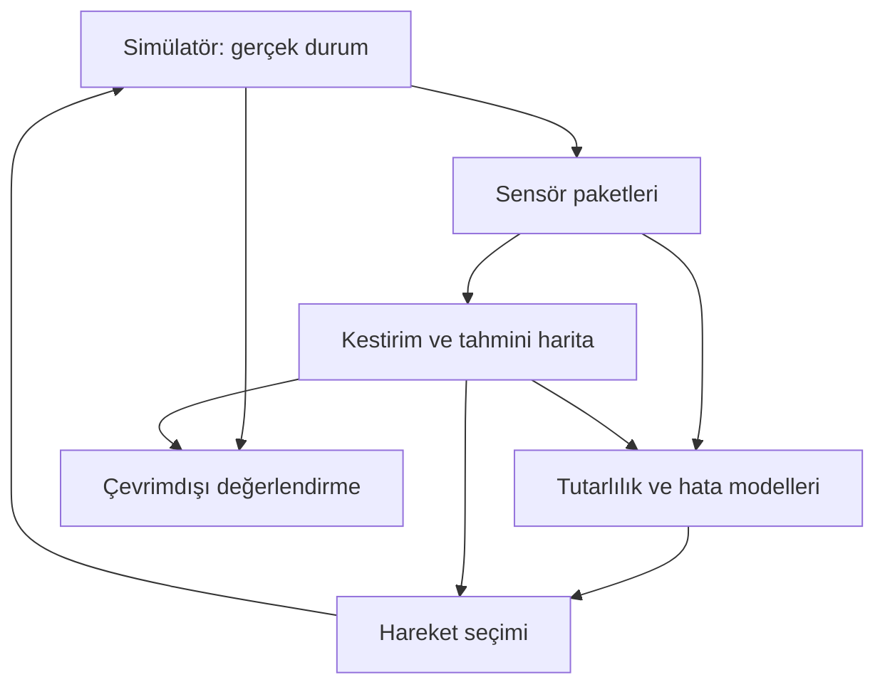

# Sistem mimarisi

[Dokümantasyona dön](README.md)

## Tasarım ilkesi

Simülasyonun bildiği gerçek durum ile robotun tahmini ayrıdır. Deney sürücüsü gerçek konumu ve hata etiketini sonuç değerlendirmesinde kullanabilir; hareket seçici ve teşhis kodu bu bilgilere erişmez. Robotun gördüğü harita, kendi ölçümlerinden oluşturduğu tahmini haritadır.

## Klasörler ve görevleri

| Konum | Görev | Neden ayrı? |
| --- | --- | --- |
| `simulator/` | Kinematik, ortam, sensör ve hata üretimi | Ölçüm üretimini kestirimden ayırır |
| `perception/` | Noktalardan çizgi çıkarımı ve eşleştirme | Ham ölçüm ile filtre gözlemini ayırır |
| `estimation/` | SLAM çekirdekleri, tutarlılık izleme ve karar | Robotun erişebildiği bilgilerle çalışır |
| `experiments/` | Kontrollü koşullar, politika çalıştırma ve değerlendirme | Araştırma protokolünü çekirdekten ayırır |
| `dataset_loaders/` | Gerçek kayıt ayrıştırma | Simülasyondan bağımsız giriş sağlar |
| `analytics/` | Kayıtlardan tablo ve grafik üretimi | Sonuç toplarken deneyi yeniden çalıştırmaz |
| `visualization/` | Kaydedilmiş çalışmanın gösterimi | Çizim ile karar üretimini ayırır |
| `tests/` | Geometri, filtre ve protokol kontrolleri | Değişikliklerin etkisini denetler |

## Çevrim içi işlem

1. Encoder ve gyro paketiyle robot durumu tahmin edilir.
2. LiDAR taramaları, haritaya işlenmeden önce tutarlılık bakımından incelenir.
3. Şüphede LiDAR düzeltmeleri ve yeni çizgi ekleme askıya alınabilir; encoder/gyro ile hareket tahmini sürer.
4. Destekli ham taramalardan rakip geometrik modeller değerlendirilir.
5. Alarm doğrulandığında adaptif politika uygulanabilir düz/yay adaylarını puanlar.
6. Seçilen komutlar simülatöre uygulanır; yeni ölçümler teşhis kanıtını günceller.
7. Gerçek konum ve etiket kullanılarak çevrimdışı ölçüler hesaplanır.

## Bilgi sınırı ve karar ilişkisi

Gerçek durumdan karar mekanizmasına doğrudan bağlantı yoktur. Değerlendirme sonucu, çalışan seçiciye geri beslenmez.

## Önemli modüller

| Modül | Sorumluluk |
| --- | --- |
| `estimation/line_ekf_slam.py` | Ortak robot/çizgi durumu ve kovaryans |
| `estimation/fastslam1.py`, `fastslam2.py` | Parçacıklı çizgi haritalama uyarlamaları |
| `estimation/slam_backend.py` | Çekirdeklerin ortak erişimi |
| `estimation/active_pipeline.py` | Kestirim, izleyici, politika ve kayıt döngüsünü birleştirme |
| `estimation/configurable_geometry.py` | Yapılandırılmış sensör kimlikleriyle izleme, model ve aday hesabı |
| `estimation/scan_alignment_guard.py` | Ham tarama hizalama tutarlılığının temel izlemesi |
| `estimation/gps_consistency.py` | GPS ölçümünün ayrı referansla tutarlılığı |
| `perception/line_features.py`, `line_association.py` | Çizgi çıkarımı ve veri eşleştirme |

Önceki iki-LiDAR deneylerinin `hypothesis_motion.py` ve `raw_scan_hypotheses.py` modülleri geçmiş karşılaştırmaları yeniden üretmek için korunur. Güncel yapılandırılabilir yol ile eski deneylerin birebir aynı protokolü kullandığı varsayılmaz.

## GPS açıkken iki kestirim yolu

Karar referansı GPS düzeltmesi almaz. İsteğe bağlı ikinci kestirici, tutarlılık denetiminden geçen GPS ölçümlerini füzyona alır. Böylece GPS'nin kendi sapması referansı doğrudan aynı yönde sürüklemez. Referans yine LiDAR/odometri hatası taşıyabilir; hatasız veya istatistiksel olarak bağımsız değildir.

## Sonuç sınırı

EXP-42 sürücüsü ek ortamları yalnız ölçüm üreticisinde kurar. Politika aynı tahmini harita ve ölçüm arayüzünü kullanır. Yeni ortamın kusursuz geometrisi planlayıcıya verilmez. Kaynak dosya ve kalibrasyon özetleri, değerlendirme boyunca eski çekirdeklerin değişmediğini denetler.
